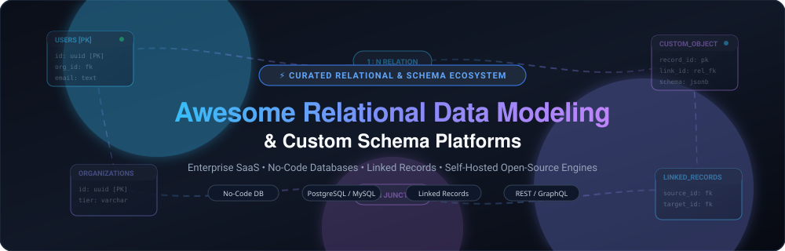

# 🗄️ Awesome Relational Data Modeling & Custom Schema

### 🚀 Top Relational Data Modeling & Custom Schema Ecosystem

**Curated List of SaaS Products & Open-Source GitHub Projects**  
*Focused on No-Code Databases, Custom Schema Design, Linked Records & Self-Hosted Relational Platforms*  
**Last updated: November 2026**

---

### 📖 Overview & SEO Keywords
This repository is an authoritative directory and comparative guide for **Relational Data Modeling**, **Custom Schema Design**, **No-Code Databases**, and **Self-Hosted SQL & Airtable Alternatives**. Whether you are architecting multi-table entity-relationship workflows in an enterprise CRM, spinning up rapid citizen-developer prototypes, or deploying self-hosted relational backends with automated REST/GraphQL APIs, this list provides comprehensive technical and pricing benchmarks.

**Primary Keywords:** Relational Data Modeling, Custom Schema, No-Code Database, Low-Code Database, Linked Records, Foreign Key Management, Entity-Relationship Modeling, Airtable Alternative, Self-Hosted Relational DB, Postgres No-Code Admin.

---

## 📊 Sector Overview & Market Dynamics

The global market for **No-Code Databases & Low-Code Application Platforms (LCAP)** is estimated at **$30–$50 billion** (projected to exceed $100 billion by 2030 at a 25–30% CAGR), operating alongside the mature **Relational Database Management System (RDBMS) & Data Modeling Tools** market valued at **$60–$70 billion**.

The sector exhibits **moderate-to-high fragmentation**: while enterprise CRM and data giants (Salesforce, HubSpot, Zoho) dominate ecosystem-tied customer master data, the independent relational no-code and visual database tier remains highly competitive and fragmented across venture-backed SaaS innovators (Airtable, Coda, SmartSuite, Quickbase) and a rapidly surging ecosystem of production-grade open-source self-hosted alternatives (NocoDB, Directus, Teable, Baserow).

---

## 📑 Table of Contents

- [📊 Sector Overview & Market Dynamics](#-sector-overview--market-dynamics)
- [☁️ SaaS/Hosted Platforms](#️-saashosted-platforms)
- [🔓 Open-Source GitHub Projects](#-open-source-github-projects)
- [🏗️ Architectural Comparison: Commercial vs. Open-Source](#️-architectural-comparison-commercial-vs-open-source)
- [⭐ Star History](#-star-history)
- [🤝 Support & Sponsoring](#-support--sponsoring)
- [✍️ How to Contribute](#️-how-to-contribute)
- [⚖️ Disclaimer](#️-disclaimer)

---

## ☁️ SaaS/Hosted Platforms

The following SaaS platforms enable teams to build custom schemas, linked records, and relational databases. Sorted by **Company Size / Revenue / Valuation (Descending)**:

| 🏢 Platform | 💰 Company Size (Revenue / Valuation) | 💳 Starting Tier Pricing | 🎁 Free Tier / Trial Limits | 🛠️ Description & Key Capabilities |
| :--- | :--- | :--- | :--- | :--- |
| **[Salesforce Data Cloud](https://developer.salesforce.com/docs/data/data-cloud-dmo-mapping/guide/c360dm-model-data.htm)** | ~$35B+ Annual Revenue / ~$300B+ Market Cap | $60,000 to $108,000/year (Consumption-based Data Cloud Starter bundle) | **Included $0 Provisioning Tier** (for Enterprise/Unlimited edition customers) with 250,000 Data Services credits, 1 TB data storage, 1 Data Cloud admin, and 1,000 Permission Set Licenses; 30-day trial for new evaluations. | Standard & custom Data Model Objects (DMOs) built on Customer 360 data model; physical and virtual views of Data Lake Objects with automated starter data bundle mappings. |
| **[HubSpot Custom Objects](https://knowledge.hubspot.com/object-settings/create-custom-objects)** | ~$2.5B+ Annual Revenue / ~$30B+ Market Cap | $150/seat/month (Sales/Service Hub Enterprise) or $4,300/month (Customer Platform Enterprise) | **No free tier** for custom objects (strictly gated to Enterprise tiers); 14-day free trial on request. Limits: max 10 custom objects per portal, up to 500 properties per object. | Model domain-specific business entities (e.g., assets, subscriptions, real estate) directly related to native CRM contacts, companies, and deals with relational integrity. |
| **[Airtable](https://www.airtable.com/)** | ~$11B Valuation / ~$300M+ ARR | $20/seat/month (Team plan, billed annually) | **Free Forever Plan**: 1,000 records per base, 1 GB attachment storage per base, up to 5 editors, unlimited bases, and 100 automation runs per month. | Benchmark relational spreadsheet-database hybrid with 20+ field types, many-to-many linked records, rollups, lookups, and Interface Designer for custom internal apps. |
| **[Zoho Creator](https://www.zoho.com/creator/)** | ~$1.4B+ Annual Revenue (Zoho Corp) | $8/user/month (Standard plan, billed annually) | **Free Forever Plan**: 1 active application, 1 user, 5,000 total records across account, and 250 MB file/attachment storage. 15-day free trial for paid tiers. | Low-code relational application builder with Lookup fields (1:N), subforms, master-transactional architecture, and Deluge scripting for custom business logic. |
| **[Quickbase](https://help.quickbase.com/docs/creating-table-to-table-relationships)** | ~$200M+ ARR / $1B+ PE Valuation (Vista Equity) | $35/user/month (Team plan, billed annually, 20-user minimum requirement) | **30-Day Free Trial** with full access to Business tier features; no permanent free plan. | Visual table-to-table relationships, parent-child hierarchies, cross-app relationships, and enterprise role-based governance for operations and workflow tracking. |
| **[Coda](https://coda.io/)** | ~$1.4B Valuation | $10/Doc Maker/month (Pro plan, billed annually; Editors/Viewers are free) | **Free Forever Plan**: Unlimited doc makers and editors, un-nested/nested docs up to 50 objects per doc, 1,000 rows per table, and 35 automation runs per month. | Document-database hybrid with bidirectional linked relations, cross-doc synchronization, formula-driven schemas, and native interactive canvas interfaces. |
| **[Caspio](https://www.caspio.com/)** | ~$50M–$100M Estimated Revenue | $300/month (Team plan, includes unlimited app users) | **14-Day Free Trial** with full visual app builder and database feature access (no credit card required); no permanent free plan. | Relational database engine supporting complex schema design, visual datapages, unlimited end-users, and embeddable database apps with strict data compliance. |
| **[SmartSuite](https://www.smartsuite.com/features/tables)** | ~$50M–$100M Estimated Valuation | $15/user/month (Team plan, billed annually, 3-user minimum requirement) | **14-Day Free Trial** of the Professional Plan (no credit card required, unmetered access); no permanent free plan. Starting plan capped at 5,000 records per solution. | Work management and relational database suite with 44+ field types, relational linked record graphs, automated rollups, and up to 25 linked tables per Solution. |
| **[Knack](https://www.knack.com/)** | ~$20M–$40M Estimated Revenue | $59/month ($49/month billed annually for Starter plan, unlimited users) | **14-Day Free Trial** capped at 10,000 records, 250 MB file storage, and 2,500 daily API requests; no permanent free plan. | Managed relational database builder with automated foreign key resolution, connected tables, user role hierarchies, and frontend portal generation without SQL. |
| **[Baserow](https://baserow.io/)** | ~$10M–$20M Estimated Valuation | $12/user/month (Premium Cloud, billed annually) | **Free Forever Cloud Plan**: Unlimited bases, unlimited databases, up to 3,000 rows per workspace, and 2 GB total file storage. | Managed cloud offering of the open-core Baserow database, delivering modular table linking, foreign-key rollups, webhooks, and visual interface construction. |

---

## 🔓 Open-Source GitHub Projects

Open-source relational database platforms provide self-hosted control, zero vendor lock-in, customizable schemas, and REST/GraphQL API generation directly over PostgreSQL or MySQL engines.

Sorted by **GitHub Star Count (Descending)**:

### 1. 🥇 [NocoDB](https://github.com/nocodb/nocodb)

- **Repository**: [nocodb/nocodb](https://github.com/nocodb/nocodb)
- **Tech Stack**: 🌐 TypeScript, Node.js, Vue.js (Connects to PostgreSQL, MySQL, SQL Server, SQLite)
- **Overview**: The leading open-source Airtable alternative. Transforms any existing relational SQL database into a smart spreadsheet UI.
- **Key Capabilities**: Grid, Kanban, Gallery, and Form views; relational links, lookups, and rollups; auto-generated REST and GraphQL APIs; role-based access control (RBAC); Docker & Kubernetes deployment.

### 2. 🥈 [Directus](https://github.com/directus/directus)

- **Repository**: [directus/directus](https://github.com/directus/directus)
- **Tech Stack**: 🌐 TypeScript, Node.js, Vue.js (PostgreSQL, MySQL, SQLite, Oracle, MS SQL)
- **Overview**: Open-source data engine and relational headless CMS that wraps SQL schemas with a real-time REST/GraphQL API and no-code data management dashboard.
- **Key Capabilities**: Complete custom schema builder, complex relational modeling (M2M, M2O, O2M, M2A / Any-to-Many), granular field-level permissions, and dynamic webhooks/flows.

### 3. 🥉 [Teable](https://github.com/teableio/teable)

- **Repository**: [teableio/teable](https://github.com/teableio/teable)
- **Tech Stack**: 🌐 TypeScript, React, Next.js, PostgreSQL
- **Overview**: High-performance, open-source spreadsheet-database hybrid built natively on top of PostgreSQL with real-time multi-user collaboration.
- **Key Capabilities**: Million-row performance capability, true Postgres foreign key schema representations, SQL query view, comprehensive field types, and REST API access.

### 4. ⚡ [APITable](https://github.com/apitable/apitable)

- **Repository**: [apitable/apitable](https://github.com/apitable/apitable)
- **Tech Stack**: 🌐 Java, TypeScript, React
- **Overview**: API-centric visual database and collaborative spreadsheet infrastructure alternative to Airtable.
- **Key Capabilities**: Visual schema designer, relational record links, cascading drop-downs, two-way automated syncing, REST APIs, and embedded widget extensions.

### 5. 📗 [Grist](https://github.com/gristlabs/grist-core)

- **Repository**: [gristlabs/grist-core](https://github.com/gristlabs/grist-core)
- **Tech Stack**: 🌐 Python, JavaScript, SQLite
- **Overview**: Open-source relational spreadsheet that combines database power with Python formulas and visual layout flexibility.
- **Key Capabilities**: Multi-table relational modeling, Python formula engine, linked views (master-detail records), access-control rules per record/column, and full self-hosting.

### 6. 🧱 [Baserow](https://github.com/baserow/baserow)

- **Repository**: [baserow/baserow](https://github.com/baserow/baserow)
- **Tech Stack**: 🌐 Python, Django, Nuxt.js, PostgreSQL
- **Overview**: Open-core no-code relational database platform built on PostgreSQL for creating modular business tools and micro-applications.
- **Key Capabilities**: 25+ field types, foreign-key relational linking, rollups, lookups, formula builder, built-in workflow automations, visual application builder, and Docker/Railway setup.

### 7. 🐘 [Mathesar](https://github.com/mathesar-foundation/mathesar)

- **Repository**: [mathesar-foundation/mathesar](https://github.com/mathesar-foundation/mathesar)
- **Tech Stack**: 🌐 Python, Svelte, TypeScript, PostgreSQL
- **Overview**: Open-source intuitive web UI designed specifically for PostgreSQL databases, allowing technical and non-technical users to build and modify relational schemas.
- **Key Capabilities**: Direct PostgreSQL schema modeling, foreign key relationship visualization, custom constraints, table exploration, and non-destructive schema modifications.

### 8. 🌽 [Saltcorn](https://github.com/saltcorn/saltcorn)

- **Repository**: [saltcorn/saltcorn](https://github.com/saltcorn/saltcorn)
- **Tech Stack**: 🌐 JavaScript, Node.js, PostgreSQL, SQLite
- **Overview**: Completely open-source, extensible no-code database and web application builder with point-and-click schema and UI design.
- **Key Capabilities**: Relational data modeling, table join visualizers, custom views (lists, cards, show views), integrated user permission models, and plugin architecture.

---

## 🏗️ Architectural Comparison: Commercial vs. Open-Source

| 🔍 Dimension | 🏢 Commercial SaaS (Airtable, Salesforce, HubSpot) | 💻 Open-Source Self-Hosted (NocoDB, Directus, Teable, Baserow) |
| :--- | :--- | :--- |
| **🔐 Data Ownership & Privacy** | Vendor-hosted; subject to cloud tenancy rules | 100% self-hosted on your own infrastructure (PostgreSQL/MySQL); air-gapped ready |
| **📐 Schema Flexibility** | Proprietary internal engines; exportable via APIs | Native standard SQL database tables and foreign keys directly readable by external tools |
| **🔌 Extensibility & Integrations** | Pre-built out-of-the-box ecosystems (CRM, Zapier, native apps) | REST/GraphQL APIs, custom webhooks, Docker containers, and custom code modules |
| **💲 Cost at Scale** | Scales linearly per seat or data volume; can become expensive | Infrastructure-based hosting costs only (compute & storage); unlimited users on core plans |

---

## 🌟 Star History

---

## 💖 Support & Sponsoring

If you found this curated directory helpful for your architecture, database design, or technology selection, please consider supporting the project!

- ⭐ **Star this repository** to help others discover it.
- 🍴 **Fork and share** with fellow developers, system architects, and no-code builders.
- ☕ **Buy a coffee or become a sponsor**: Support ongoing maintenance and continuous updates on the [GitHub Sponsors Dashboard](https://github.com/sponsors/ishandutta2007).

Thank you for being part of the community and keeping data modeling open, powerful, and accessible! 🙌

---

## ✍️ How to Contribute

1. Fork the repository.
2. Add or update entries in `README.md` conforming to the tabular SaaS format or ranked open-source format.
3. Ensure all links, descriptions, pricing data, free tier limits, and GitHub statistics are factual and verified.
4. Submit a Pull Request with a descriptive summary of your changes.

---

## ⚖️ Disclaimer

- This is a **community-curated list** for informational and educational purposes.
- Commercial trademarks and product names belong to their respective companies.
- Always review current software licensing agreements (e.g., AGPL, Apache 2.0, MIT, or Business Source Licenses) before using open-source tools in enterprise commercial environments.
